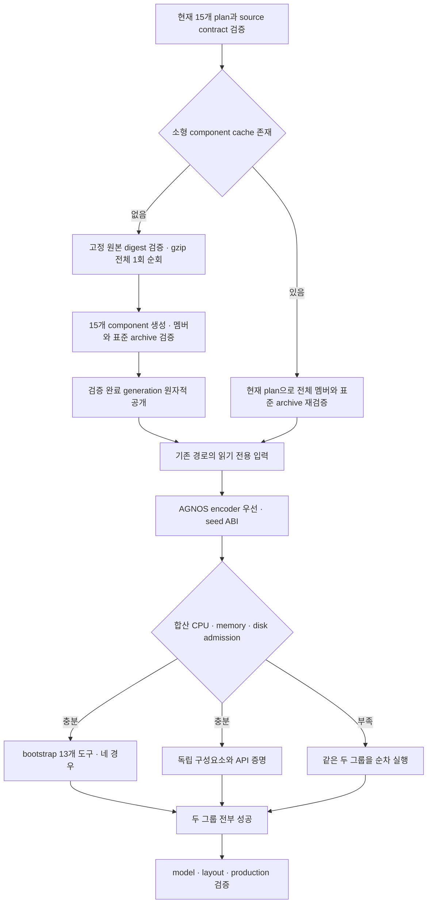

# 검증을 유지하는 CI 병목 개선 — #649

추적: [#649](https://github.com/bin9208/openpilot-rust/issues/649), [#598](https://github.com/bin9208/openpilot-rust/issues/598), [#600](https://github.com/bin9208/openpilot-rust/issues/600), [#605](https://github.com/bin9208/openpilot-rust/issues/605).

## 현재 소스와 우선순위

- 2026-11-01 사용자가 이 작업을 우선하고 다른 세션의 기존 #598 구현을 보류했다.
- 기준 소스는 PR #611의 `44fbc7a34526950063713fd8255b96b0e543f554`다. 기존 입력과 encoder fresh 회귀 수정은 보존한다.
- 별도 작업 트리의 `codex/fix-649-ci-bottlenecks`에서 구현한다. 기존 체크아웃의 미커밋 수정과 실행 중인 Actions는 보존한다.
- `bin-actions2/3`는 사용자 정비 중이다. 러너 복구·서비스 시작·기기 접속을 하지 않는다. 온라인 복구는 사용자가 직접 한다.
- dev-md는 콤마 설치용 최상위 통합 브랜치다. CI DAG 변경은 별도 dev-md PR로 검증하며 dev/main으로 역통합하지 않는다.

## 구현과 검증 상태

이 문서는 커밋 시점의 단계별 증거다. 이후 최종 SHA·Actions·시간·남은 실패는 [#649의 작업 기록](https://github.com/bin9208/openpilot-rust/issues/649)에 이어서 갱신한다.

### AGNOS의 MPC load-owner 후속 수정

`73f230dde6e1a641c36469ab88c4ff3c39be7045`의 [41255972219](https://github.com/bin9208/openpilot-rust/actions/runs/41255972219)는 companion의 독립 11개·acados 문맥 3개 root(고유 13개)를 모두 통과했다. 이어지는 source-bound MPC에서도 실제 Rust/C ABI solve 12회가 비트 단위로 일치했지만, 기존 독립 ELF 감사가 BLASFEO/HPIPM의 `sqrt`·`sqrtf`를 다시 누락으로 판정했다. artifact `13065053512`에 원래 실패와 단계별 시간을 보존했다. 전체 실행은 실패이며 bootstrap 자식은 이 실패 뒤 소유 scope 정리로 종료됐으므로 bootstrap 자체 결함으로 해석하지 않는다.

Rust `solver/api.rs`와 독립 ctypes 기준이 실제로 여는 `libacados_ocp_solver_lat.so`·`libacados_ocp_solver_long.so` 각각의 기존 `--load-owner` 문맥에서 두 의존성을 검사한다. 원래 8개 MPC root와 alias는 모두 유지하며 나머지 6개 root의 독립 검사도 유지한다. 범용 ELF validator·provider pin·solver 정밀도·12회 비트 일치 조건은 바꾸지 않는다. 실제 표준 ARM 재현에 같은 solver 비교, ownerless 거부 및 두 owner의 전체 root 검증을 추가한다. 전체 AGNOS 재성공은 별도 필수 조건으로 남긴다.

같은 artifact의 batch 본체는 warm 150.337초, 원본 순회·원본 읽기·HTTP body 전송 모두 0을 기록했다. 이는 본체 시간이며 도구 컴파일을 포함한 외부 step 전체 시간과 구분한다.

### DBC 원본 도구의 최소 runner context — #659

`d3e7c7e7cc2ddd972676273ed266b86f3d6ec395`의 [AGNOS 41262958993](https://github.com/bin9208/openpilot-rust/actions/runs/41262958993)은 MPC·Panda를 통과한 뒤 DBC 원본 도구의 Actions admission에서 실패했다. artifact `13068570172`에 `env -i`가 runner context를 지워 원래 generator 실행 전에 거부한 증거를 보존했다. provider 103개 DB 검증과 source contract·재사용 검사는 성공했으나 원본 비교는 미실행이므로 전체 성공으로 인정하지 않는다.

부모가 GitHub-hosted Linux ARM64임을 다시 확인한 뒤 네 실제 메타데이터만 해당 도구에 전달한다. 고정 guest 환경·기존 admission·140입력/103출력의 byte 비교는 유지하고 token·부모 PATH/PYTHONPATH는 전달하지 않는다. 잘못된/누락된 context 거부와 실제 표준 ARM의 `env -i` 재현, 전체 AGNOS 결과를 [#659](https://github.com/bin9208/openpilot-rust/issues/659)에 기록한다.

- [x] 같은 원본의 15개 provider를 한 번 순회하고 검증된 작은 component를 재사용한다.
- [x] 기존 단일 provider의 descriptor/archive/tree와 동등성을 Actions에서 확인한다.
- [x] 실제 같은 입력·러너에서 cold 12분 이하, warm 3분 이하를 확인한다.
- [ ] recovery를 독립 검사로 옮기고 공개 gate에 같은 source/base/실제 execution 증거를 결속한다.
- [ ] PTY 종료의 원래/네이티브 실패를 정확히 재현하고 재시도/허용값 완화 없이 수정한다.
- [ ] AGNOS 단계 계측과 자원 admission 기반 독립 그룹, UI/Card case 병렬화를 확인한다.
- [ ] dev-md의 불필요한 직렬 needs와 오래된 fast checks 요구를 정리하고 기존 4개 gate·전달 조건을 검증한다.

로컬은 Rust 서식·구문과 diff만 확인한다. 기능·빌드·성능·ARM/AGNOS 결과는 Actions로 확인한다. 구현이나 실행 등록만으로 성공 처리하지 않는다.

## Provider batch 인터페이스

공통 Rust PR에서는 독립 recovery와 workspace·모듈 검사가 각각 실행되고, 기존 `rust checks`는 모두의 성공을 요구한다. 입력 공개 도구는 별도 수동 실행에서 source SHA·PR base·실제 실행 attempt·runner 영수증을 다시 확인한다. UI는 세 그룹의 전체 13개 case가 성공해야 하며, Card/CAN은 전체 reference 성공 후 IPC lifecycle에 진입한다.

`build-runtime-ffmpeg --export-released-provider-batch --plan ... --plan ... --source-root ... --cache ... --store ... --output ...`는 같은 원본의 profile을 일괄 준비한다. 기존 단일 명령은 유지한다.

batch의 profile별 Export는 기존 필드를 유지하며 `origin`은 작은 component에서 원본 manifest/provenance와 현재 plan을 검증한 prefix다. `origin.asset`은 실제 소비한 component 파일의 영수증이며 원본 전체를 새로 내려받았다고 주장하지 않는다. 원본 전체의 SHA와 실제 순회·전송량은 batch 최상위에 따로 기록한다.

캐시 적중에도 작은 archive의 전체 멤버·크기·mode·alias·manifest를 검사하고 현재 source contract를 다시 확인한다. 저장 영수증을 기대값의 근거로 삼지 않는다. 기존 프로젝트 실행 파일은 선택하지 않으며 source-bound MPC/Panda/DBC/eGPU 입력에는 기존 계약을 유지한다.

## 2026-11-01 중간 증거

- provider 계약 검사 `a2d5f93839fcfc900c0774abe406fe5b1cc922fc`, [Actions 41235682321](https://github.com/bin9208/openpilot-rust/actions/runs/41235682321): 기존·신규 안전성/동등성 16개 통과. 뒤따른 Clippy의 불필요한 참조 1건 때문에 전체 실행은 실패했다. 해당 경고는 `49ec9d63d`에서 수정하고 실제 ARM 비교를 [41235936846](https://github.com/bin9208/openpilot-rust/actions/runs/41235936846)에 요청했다. 성능 목표 달성은 아직 확인하지 않았다.
- recovery 비교 명령과 evidence 업로드를 변경하지 않고 독립 hosted X64 작업으로 이동했다. workspace의 fmt/Clippy/전체 Cargo test/build는 유지한다. 최종 `rust checks`와 입력 공개 gate 모두 recovery 성공 및 별도 원본 PR 실행 영수증을 요구한다.
- PTY EOF와 `Popen.poll()` 사이의 경합을 확인했다. 최초 수정의 원본 파일 변경은 MPC의 전체 원본 contract를 무효화해 되돌렸다. 비교 listener의 명시적 관측 경계에서 해당 자식을 잠금 밖에서 최대 2초 회수하며 실제 종료 코드만 전달한다. 원본 함수 본문·고정 source contract와 native 비교 assertion은 유지하고, 관측 전 `None`과 실제 자식 종료 코드를 별도 기록한다. 0/7을 구별하는 실제 자식 재현을 Actions에 추가했다. 런타임 정책·권한·입력 제한은 바꾸지 않는다.

## 독립 case 실행 구조

- UI는 정책·기하 5개, 픽셀 5개, lifecycle·안전 3개로 나눈다. 각 그룹은 별도 프로세스·Xvfb·DISPLAY·TMPDIR·IPC prefix·출력 경로를 소유한다. 전체 13개가 중복·누락 없이 성공해야 최종 PASS다.
- Card/CAN은 원래 shared·브랜드·CAN 비교의 명령·인수를 그대로 case 목록으로 옮긴다. 실제 affinity와 가용 메모리/cgroup·합산 예상 디스크 증가량으로 동시 수를 정한다. IPC lifecycle은 reference의 완전한 성공 영수증을 읽은 뒤에만 시작한다.
- Cargo/test의 새로운 전역 제한을 추가하지 않는다. 폐지된 25/35 GiB 고정 규칙이 남아 있던 Card 공통 admission과 UI safety의 사전 검사만 작업별 증가량으로 바로잡는다.
- Actions 회귀 검사는 기존 소스의 모든 case/argv와 새 목록을 비교하고, 실제 자식 프로세스의 동일 임시 파일명·IPC prefix 격리 및 실패 전파를 검사한다. 실제 UI/Card 성공과 병목 개선은 전체 필수 Actions에서 추가 확인해야 한다.

## AGNOS 구성과 encoder 재사용 실패 원인

- 기존 #598의 `44fbc7a34526950063713fd8255b96b0e543f554` [Actions 41222239366](https://github.com/bin9208/openpilot-rust/actions/runs/41222239366)은 encoder 재사용의 `fresh` assertion에서 실패했다. 보존 artifact의 Cargo fingerprint는 `openpilot/system/hardware/comma/agnos.json`의 원래 dangling symlink를 매번 missing으로 판정했다. 초기/재사용 encoder 바이트는 같았으나 실제 불필요한 재빌드가 발생했으므로 성공으로 인정하지 않는다.
- logging/loggerd의 build script는 사라진 tracked 입력의 기존 부모를 관측하도록 고친다. Git HEAD/index/ref와 실제 소스 변경 감지는 유지한다. 실제 Cargo 재사용 검사에 dangling symlink와 링크 변경을 포함한다. `fresh` assertion을 제거하거나 재시도하지 않는다.
- AGNOS는 공통 준비·encoder·seed·각 구성요소·model·최종 layout/production의 시간과 실패를 기록한다. seed 준비 이후 독립 bootstrap 도구 증명과 구성요소를 같은 작업에서 병행한다. bootstrap의 기존 네 경우/13개 도구·원래 argv/검증 조건은 유지한다. 합산 memory/disk/affinity admission이 부족하면 순차 실행한다. bootstrap의 별도 target/store와 출력만 사용하며 두 그룹 성공 후 최종 단계에 진입한다.

## 표준 archive와 현재 통합 상태

캐시 descriptor의 digest 자체는 독립 pin이 아니므로 소형 component의 멤버 검증 뒤 기존 exporter의 표준 archive 바이트도 재계산해 비교한다. payload가 같더라도 gzip header만 바꾸고 descriptor까지 위조한 캐시는 거부한다. 원본 전체 archive를 warm 경로에서 읽거나 해제하지 않는다.

최신 집중 검증 `439d0a94987617d3ab38a93e41d1305fea7b2581`의 [41236609075](https://github.com/bin9208/openpilot-rust/actions/runs/41236609075)는 provider·logging Cargo 재사용·recovery 전체·공개 gate·원래 case/명령·AGNOS 병행 경계가 모두 성공했다. [PR #611](https://github.com/bin9208/openpilot-rust/pull/611)에 같은 SHA를 이어 붙여 전체 필수 검증과 AGNOS를 실행 중이다. 후속 Card 회귀와 표준 archive 검사 변경은 다시 집중 검증한 뒤 갱신한다.

[PR #606](https://github.com/bin9208/openpilot-rust/pull/606)의 `53636ff7bcd794d5990af0b913ef7dbb5a9ff422`와 비교해 native-cache·다운로드 캐시·action archive 캐시 구현이 동일함을 확인했다. 이를 재작성하지 않는다. PR #611의 추가 PR 실행 영수증·native ARM 경로는 그대로 보존한다. 두 PR의 기존 통합·병합 후 검증은 미완료이며 이 작업을 이유로 우회하지 않는다.

세 X64 러너의 label은 GitHub 등록 메타데이터에서 일치시켰다. ID24에 `openpilot-rust`만 추가했고 ID23/24의 offline 상태와 기존 label은 유지했다. 서비스 시작·정비 복구·Actions 취소를 하지 않았다.

## 2026-11-01 후속 검증

- `38d12c49ef6c34e0c4b005f8b4c7f76a04678511`의 [집중 검증 41239747046](https://github.com/bin9208/openpilot-rust/actions/runs/41239747046)은 provider 17개·실제 Cargo 재사용·recovery 전체·공개 gate 33개·기존 명령 및 병렬 경계 검사를 모두 통과했다.
- 같은 exporter/lock을 사용하는 `96db9a64b77b35a4918611c984c8c9a4f422a1bb`의 [AGNOS 41238362335](https://github.com/bin9208/openpilot-rust/actions/runs/41238362335)는 입력 준비에서 전체 원본 1,155,969,168 bytes를 정확히 한 번 순회하고, 기존 raw cache로 HTTP body 전송 0 bytes, batch 자체 354.892초를 기록했다. 해당 실행 전체는 이후 계측 함수 이름 충돌로 실패했으므로 전체 성공·warm 성능 증거로 사용하지 않는다. 현재 후보는 이 이름 충돌과 기존 PRoot guest export 경로 호환성을 수정했다.
- [실제 ARM 비교 41238463727](https://github.com/bin9208/openpilot-rust/actions/runs/41238463727)은 cold/warm 뒤 기존 단일 export 15개와 tree·descriptor·archive를 같은 VM에서 비교 중이다. 전체 성공과 warm 3분 목표는 아직 미확정이다.
- 감사에서 새 batch 하위 모듈과 AGNOS 준비 helper의 push 경로 누락을 확인했다. 기존 branch/event 범위를 유지하면서 이 의존 경로만 추가한다. batch의 순회·바이트·전송·시간 영수증도 기존 artifact에 명시적으로 보존한다.

## 2026-11-01 실제 ARM 비교와 후속 실패

- 초기 exporter `49ec9d63da7fdf60d822f7803ae7c7bc977fb1da`의 [41235936846](https://github.com/bin9208/openpilot-rust/actions/runs/41235936846)은 15개 전부의 tree·descriptor·archive 바이트 일치를 통과했다. 같은 VM의 기존 8개 companion 합계는 3,704.567초, batch cold 443.346초(원본 1회), warm 89.300초(원본 없음·순회/전송 0)다. 별도 원본 prefetch는 125.731초다. 이후 추가된 표준 archive 재계산까지 포함하는 최신 exporter 성능은 [41238463727](https://github.com/bin9208/openpilot-rust/actions/runs/41238463727)에서 계속 확인한다. 초기 수치를 최신 구현의 완료 증거로 대체하지 않는다.
- `38d12c49ef6c34e0c4b005f8b4c7f76a04678511`의 [AGNOS 41240265625](https://github.com/bin9208/openpilot-rust/actions/runs/41240265625)는 encoder의 원본 codec 5개·실제 Cargo fresh 재사용과 seed ABI를 통과했다. admission은 4 CPU, 가용 memory 15.54 GB, disk 100.49 GB로 두 그룹 병행을 허용했다. 이후 기존 companion fixture의 `ILP64 SVD result` assertion에서 실패했고, 이에 따라 새 bootstrap 자식만 종료됐다. cgroup OOM/limit event는 0이었다. 전체 성공으로 인정하지 않는다.
- 정확한 반환값이 기존 stderr에 없어 fixture에 16진 부동소수점 진단을 추가한다. 별도 수동 ARM 재현은 동일 provider를 현재 plan과 표준 archive까지 재검증한 뒤 원래 SVD assertion을 그대로 실행한다. 수치 허용값·runtime 정책·원본 비교를 완화하지 않고 원인을 먼저 확인한다.
- [#653 수동 ARM 재현 41247090318 / job 124672660333](https://github.com/bin9208/openpilot-rust/actions/runs/41247090318/job/124672660333)의 artifact `13060455328`에서 실제 `info=0`, singular 값 `0x1.7ffffffffffffp+1`, `0x1.0000000000001p+1`을 확인했다. 각각 3의 바로 아래, 2의 바로 위 double이며 1 ULP 차이다. tree `5e4960d1cd4d595ff4b6727f2a84b91699d1759772ccf6ff3c5acb77a8dea777`와 archive `0590119e68a7a119581e4817dc1334fb7f921f5106dc7dadc14d2465822b8de8`는 기존 단일 export와 일치한다.
- 원래 diag(3,2) SVD case를 유지하면서 이 작은 CI ABI fixture만 인접 double 한 칸으로 제한한다. 2 ULP·실패 info·음수·순서 변경·NaN·무한대는 거부하고 diag(4,2)의 bit-exact case를 추가한다. runtime·모델 정밀도와 기존 원본 비교 기준은 바꾸지 않는다. 수정된 실제 ARM·전체 AGNOS 성공은 계속 필요하다.
- 수정 `39c9d92e2f0245352dd6ed66c1470f1f684494b6`의 [ARM job 124675426535](https://github.com/bin9208/openpilot-rust/actions/runs/41248021030/job/124675426535)은 성공했다. artifact `13059669656`은 원래 case의 같은 1 ULP 값과 추가 dyadic case의 정확한 `0x1p+2,0x1p+1`을 보존한다. 거부 경계 self-test도 같은 실행에서 성공했다. [집중 검증 41248008946](https://github.com/bin9208/openpilot-rust/actions/runs/41248008946) 전체도 성공했으며 이제 공통 PR의 전체 AGNOS에서 확인한다.

## 표준 archive 검증을 포함한 동일 VM 성능 증거

`96db9a64b77b35a4918611c984c8c9a4f422a1bb`의 [ARM benchmark job 124648578861](https://github.com/bin9208/openpilot-rust/actions/runs/41238463727/job/124648578861)과 workflow 전체가 성공했다. artifact `13059864245`는 15개 단일 export 각각과 batch의 tree·descriptor·archive 바이트 일치, 모든 case의 exit 0, 성능 assertion 성공을 보존한다.

| 같은 VM·입력·Rust 1.94.0 측정 | 초 | 결과 |
| --- | ---: | --- |
| 별도 원본 prefetch | 106.150 | 1,155,969,168 bytes 원본 준비 |
| 기존 8개 companion 합계 | 3,683.817 | 61분 24초 |
| 새 15개 전체 cold | 503.360 | 원본 gzip 1회 · 8분 23초 |
| prefetch + cold | 609.511 | 다운로드 포함 10분 10초 |
| 새 15개 전체 warm | 144.312 | 원본 경로 없음 · 순회/원본 bytes/HTTP bytes 모두 0 |

측정 소스와 공통 후보 `b9c590dc150ba57e2e4f5dad29221a6390e8fb4e`의 전체 Rust tree는 `e04c86b17bd7bc7c0912813e909ab10f82c00ca1`로 같다. benchmark job·harness·runner policy·job-temp/rust-path setup도 동일하다. 이후 #654의 테스트 command 생성 경계 수정은 아래에서 따로 검증하며 provider exporter·profile·contract·archive 형식은 유지한다. 다른 SHA의 성능 증거가 현재 SHA의 입력 공개 gate를 대신하지 않는다.

앞선 [7a89ba78f ARM job 124645339328](https://github.com/bin9208/openpilot-rust/actions/runs/41237656640/job/124645339328)도 15개 동등성·cold 549.405초·warm 178.761초로 성공했다. 당시 workflow의 별도 execution-contract는 누락된 Python `zstandard` 때문에 실패했으나 이후 수정됐다. 실패 workflow 전체 경과를 성공 기준으로 사용하지 않는다.

이 성능 증거는 provider 처리의 수용 조건이다. 전체 필수 gate·현재 AGNOS·UI/Card 공유 입력 보호·dev-md 직렬 기준 비교는 별도로 완료해야 한다.

## ARM foundation의 가짜 curl 실행 경합 — #654

공통 후보 `b9c590dc150ba57e2e4f5dad29221a6390e8fb4e`의 [ARM foundation job 124678033356](https://github.com/bin9208/openpilot-rust/actions/runs/41248896562/job/124678033356)은 mirror 회귀의 호출 기록 누락으로 첫 library 검사에서 실패했다. 기존 나머지 실패 수집 단계에서는 34개가 모두 통과했으나 첫 실패를 성공으로 대체하지 않는다.

진단 소스 `4577f399cb375cbf131e5a4f6b3b43a22ed76a3e`의 [ARM 반복 재현 job 124679928888](https://github.com/bin9208/openpilot-rust/actions/runs/41249525491/job/124679928888)은 기본 병렬 library 검사 81번째에서 `Err(Os { code: 26, kind: ExecutableFileBusy, message: "Text file busy" })`를 보존했다. 새 fake curl 스크립트의 실행 오류가 뒤따르는 journal 읽기 오류에 가려졌다. [#654](https://github.com/bin9208/openpilot-rust/issues/654)로 추적한다.

실제 production `/usr/bin/curl` 명령·인수·retry·전송량·mirror 판정은 유지하고, private command 생성 경계에서 테스트 스크립트만 `/bin/sh`의 읽기 입력으로 전달한다. writable fd를 강제로 보유해 기존 직접 실행의 오류 26을 재현하고 새 실행은 retry 없이 성공해야 하는 회귀를 추가한다. 전역 Cargo/test 병렬 제한은 도입하지 않는다. 같은 ARM 병렬 검사 200회 전부와 전체 foundation의 성공은 후속 Actions에서 확인한다.

수정 소스 `6a8ce8bd2607b1bbf172302ea7385ee8cefe4427`의 [ARM job 124680788202](https://github.com/bin9208/openpilot-rust/actions/runs/41249815074/job/124680788202)은 **35개 × 200회 = 7,000개 모두 성공**했다. artifact `13060249876`에서 순서대로 1..200 반복, 각 반복의 35개 성공, 강제 writer-fd 회귀의 200회 성공과 실패 0을 확인했다. provider·logging 재사용·recovery 전체·공개/원래 명령 보존을 포함한 같은 workflow 전체도 성공했다. 전체 foundation과 현재 SHA 필수 gate는 계속 확인한다.

## 실제 UI admission과 혼합 비용 — #655

최초 그룹 실행 `439d0a94987617d3ab38a93e41d1305fea7b2581`의 [UI job 124642155904](https://github.com/bin9208/openpilot-rust/actions/runs/41236788017/job/124642155904)은 13개 case가 모두 성공했다. 다만 artifact `13060425296`에서 affinity 4 CPU·가용 memory 4,122,618,880 bytes·disk 51,957,874,688 bytes에 **workers=1**을 확인했다. 세 그룹이 차례로 실행돼 Xvfb `:0`을 재사용했다. 이 실행을 실제 병행 성공 증거로 취급하지 않는다. 픽셀 1,888.556초가 주된 실행 구간이었다.

[#655](https://github.com/bin9208/openpilot-rust/issues/655)는 1/1/2 GiB 그룹을 모두 최대 2 GiB로 계산한 pool 상한을 바로잡는다. 실제 비용 합으로 상한을 정하고, spawn 직전의 정확한 합산 reservation·개별 최대 case 거부·기존 CPU affinity·memory/disk 여유는 유지한다. 실제 동시 process peak·PID·시간·IPC prefix를 기록하며, 같은 budget의 실제 자식 겹침과 부족 시 거부를 Actions에서 확인한다. 최신 소스의 UI/Card 전체 성공은 계속 필요하다.

## control tools 시작 구독 정렬 — #656

`4af4aa54bc80824b786320b4a180dcababf5c3bf`의 [control tools job 124686916736](https://github.com/bin9208/openpilot-rust/actions/runs/41251875743/job/124686916736)은 원본 8 case/1,805 step mismatch 0과 5개 상태 일치 후 마지막 IPC 수거에서 실패했다. artifact `13061009772`의 239개 pair는 두 서비스 각각 중간 누락 없이 처음부터 약 한 프레임씩 어긋났다. 원본 msgq의 publisher 시작·reader 재등록 시 write pointer 초기화 때문에 첫 `controlsState`만 놓친 검사기가 서로 다른 프레임을 계속 짝지었다.

[#656](https://github.com/bin9208/openpilot-rust/issues/656)은 검사기에서 state를 먼저 읽고 원본 발행 순서의 단조 타임스탬프로 시작 구간을 정렬한다. 시작 시 짝 없는 메시지는 별도 artifact로 남기며, 실행 중 누락과 짝 없는 마지막 메시지는 실패한다. 기존 235개 이상 관측·상태별 원본 일치·발행 경과·CLI·시그널·실제 종료 코드 조건과 daemon/runtime은 유지한다. 로컬은 문법/diff만 확인하고 강제 경합 회귀 및 실제 원래 IPC 전체 검증은 Actions에서 수행한다.

## 주소 ABI 검사에 남은 폐지된 예비분 — #652

`316ad0573da933b47c8cad839d8723c92926a03d`의 [UI/connectivity job 124689288692](https://github.com/bin9208/openpilot-rust/actions/runs/41252678646/job/124689288692)은 discovery 원본 32 case/16,000 frame, 실제 HTTP 20 case와 daemon lifecycle을 성공한 뒤 `check_cweb_address.py`의 고정 26 GiB 사전 조건에서 실패했다. 주소 sanitizer/ABI 자체는 아직 시작하지 않은 상태였다.

같은 검사에서 폐지된 25 GiB 예비분만 빼고 기존 추가 증가량 1 GiB를 유지한다. 이 파일은 이미 전체 성공한 dev-md 후보 `3448238b610c4c7c53e612fc2940ac215cdfcae5`의 검증된 파일과 동일한 Git blob `2f70537e53113841cc36cf44b66ecf552f23b0ad`다. dev-md runtime을 역통합하지 않고 같은 한 줄의 운영 조건 수정만 적용한다. 실제 ASan/UBSan C++ 빌드/실행·네 인터페이스 원본 주소 비교·실패 전파는 그대로다. 임계 증가량 바로 아래/정확한 경계와 24 GiB 허용, 원본 불일치 거부를 Actions에서 확인하고 같은 원래 sanitizer/주소 검사를 집중 CI에도 실행한다.

UI/Card의 같은 하위 실행 경로도 대조했다. DBC 준비는 기존 `4 × 입력 크기 + 16 MiB`, carlog 128 MiB, factory 16 MiB, UI root/augmented/torque 512 MiB, native resource 1 GiB, updater fixture 1 MiB 증가량을 유지하고 각각의 25 GiB 예비분만 제거한다. `5a184c0e2`의 이미 검증한 guard 산술 변경만 재사용하고 현재 공통 브랜치의 UI 기능·원본 비교·sanitizer·전체 case는 유지한다. 원본 MPC/DBC/eGPU source contract에 묶인 파일은 변경하지 않는다. 이 수정은 그룹별 합산 증가량 admission과 하위 검사의 모순을 없애며 성공 시 모든 원래 case가 실행돼야 하는 조건은 유지한다.

## Companion ELF의 실제 acados load-owner — #657

`b9c590dc150ba57e2e4f5dad29221a6390e8fb4e`의 [AGNOS job 124678033771](https://github.com/bin9208/openpilot-rust/actions/runs/41248896664/job/124678033771)은 실제 numerics/SVD·GEOS·Brotli·acados API와 prefix maps를 성공한 뒤 ELF root 검사에서 실패했다. artifact `13061828803`은 13개 독립 root 중 BLASFEO/HPIPM만 `sqrt/sqrtf` 누락임을 보존한다. 실제 `RTLD_NOW | RTLD_LOCAL` owner `libacados.so`의 DT_NEEDED에는 `libm.so.6`가 있고, maps에도 같은 검증 prefix의 acados/BLASFEO/HPIPM/qpOASES 네 파일이 모두 있다.

[#657](https://github.com/bin9208/openpilot-rust/issues/657)은 기존 `runtime-elf-audit --load-owner`를 두 실제 acados 의존성에만 적용한다. 나머지 11 root는 독립 검사하고, acados owner도 독립 검사를 통과해야 한다. 모든 원래 root의 집합·개수와 성공을 확인하며, 관련 없는 component export를 합치지 않는다. 일반 ELF validator·provider 바이트·원본 pin·모델 정밀도는 유지한다.

집중 CI에서 기존 ELF owner/version/strong-symbol·잘못된 owner·관계 없는 plugin 격리 회귀를 실행한다. 별도 수동 ARM 재현은 같은 검증 component와 실제 외부 API·maps를 사용해 owner 없는 두 leaf의 정확한 `sqrt/sqrtf` 실패와 acados owner 범위의 성공을 함께 요구한다. production probe의 모든 실행은 종료 코드 0을 요구하며, ARM 진단의 owner 없는 실행만 명시적인 음성 회귀다. 독립 root 누락·교체·중복, 잘못된 owner, root 실패를 숨긴 report도 거부한다. push 집중 검증과 수동 ARM 진단은 입력 의존성이 없으므로 같은 SHA의 일반 집중 작업을 중복 실행하지 않는다. benchmark는 기존 component 선행 검사를 유지한다.

## 읽기 전용 ONNX 입력과 원본 DISK parser — #660

공통 `a9295fee82d5dff6dd4b0b4c112950b78c941c5b`는 [필수 Rust 전체 47개](https://github.com/bin9208/openpilot-rust/actions/runs/41327914371)와 Integration/docs/foundation/kernel 검사를 성공했다. [전체 AGNOS job 124911645930](https://github.com/bin9208/openpilot-rust/actions/runs/41327909368/job/124911645930)의 artifact `13097176346`에서는 실제 bootstrap 13개 도구의 initial/reused/docs/small이 모두 성공했다. 재사용·docs의 13개 binary가 모두 fresh/저장 0, 작은 변경은 해당 도구 하나만 재빌드하고 다른 12개를 재사용했다. DBC/MPC/eGPU/catalog 원본 검증도 성공했다.

그 뒤 실제 모델 생성의 첫 ONNX 파싱에서 읽기 전용 캐시를 tinygrad DISK Tensor가 `O_RDWR|O_CREAT`로 열어 `EACCES`가 발생했다. [#660](https://github.com/bin9208/openpilot-rust/issues/660)은 기존 SHA-256 확인에 읽은 동일 바이트를 CPU uint8 Tensor로 원래 parser에 전달한다. 캐시 권한·원본 tinygrad·연산/shape/정밀도·외부 tensor 금지 조건은 유지한다. 쓰기 거부를 강제로 재현한 뒤 정확 weight 바이트와 입출력 shape·파일 내용/권한 보존, 잘못된 hash·runtime shape·외부 tensor 거부를 집중 Actions에서 확인한다. 전체 genuine AGNOS의 모델 4개·재사용·layout·production이 성공하기 전 #649 완료와 #598 재개는 계속 보류한다.

## ONNX BOOL 원본 decoder의 LLVM bitcast — #661

수정 `6213c6d1d6f52c40860b025effd8fa1fd54e5557`의 [전체 Rust47개](https://github.com/bin9208/openpilot-rust/actions/runs/41340538057)는 성공했다. [AGNOS job124949361144](https://github.com/bin9208/openpilot-rust/actions/runs/41340533461/job/124949361144)의 artifact `13101627697`에서는 bootstrap13개×initial/reused/docs/small 및 원래 구성요소13개가 모두 성공했다. #660의 파일 접근도 통과했지만, 다음 initializer 읽기의 LLVM IR `bitcast i8 ... to i1`가 실패했다. 실패한 모델 단계는49.062초이며 전체 성공으로 처리하지 않는다.

[#661](https://github.com/bin9208/openpilot-rust/issues/661)은 오프라인 전용 TensorProto decoder에서 raw BOOL에만 Tensor.cast를 적용한다. 공통 tinygrad의 원래 필드·부동소수점 디코딩과 라이선스 출처를 유지하고, 기존 inline-only 정책을 적용한다. 다른 dtype의 bitcast·모델/부동소수점 정밀도·연산·compiler library는 유지한다. [ONNX1.20.1](https://github.com/onnx/onnx/blob/v1.20.1/onnx/onnx.proto3)의 0/1 한 바이트 저장을 보존하며, LLVM의 i8→i1 bitcast 음성 재현과 raw/typed true/false scalar/vector의 정확 바이트를 Actions에서 검증한다. 이 source 변경은 기존 model producer의 내용 기반 identity에 반영된다.

첫 집중 소스 `ee845df52d7f189204afff10531492a197c69b93`의 [41353840436](https://github.com/bin9208/openpilot-rust/actions/runs/41353840436)은 기존 MPC source contract가 공통 tinygrad 변경을 거부했다. 공통 파일을 원래 바이트로 복원하고 수정은 기존 오프라인 전용 파서로 한정한다. source contract·provider pin·guard 검사는 바꾸지 않는다. 같은 실행의 BOOL 양성6개와 기존5개는 통과했으며, 추가한 음성 회귀는 잘못된 `device="CPU:LLVM"` 지정으로 실패했다. 원래 CPU device와 `Context(DEV="CPU:LLVM")`를 사용하도록 회귀를 바로잡고 전체 집중 검사를 다시 확인한다. 실패 실행은 성공으로 대체하지 않는다.

집중 CI의 기존 component job에 두 실제 source ONNX의 initializer 사전 검증을 추가한다. 기존 pinned asset 준비 도구와 cache를 재사용하며 source/hash/읽기 전용 권한을 유지하고 ONNX1.20.1 numpy_helper와 dtype·shape·바이트를 대조한다. 작은 초기 회귀 후 이 검사를 실행해 긴 AGNOS의 같은 실패를 빠르게 발견한다. 실제 ARM·모델4개 생성/재사용·layout·production 검증은 그대로 유지하며, 사전 검사로 이를 대체하지 않는다. 로컬에서는 AST/YAML·diff만 확인한다.

## 실제 FP16 initializer 저장 바이트 손실 — #662

전용 BOOL decoder `f59e87d42101e1d1c17d031a8b00844c283e8273`의 [집중41354333055](https://github.com/bin9208/openpilot-rust/actions/runs/41354333055)은 ONNX12개·원래 provider17개·recovery가 성공했으나 실제 driving 모델의 첫 weight byte 비교에서 실패했다. 진단 전용 `8d0ed70c1d6175ff28008c6ca0860de3843f73e8`의 [집중41355230993](https://github.com/bin9208/openpilot-rust/actions/runs/41355230993) artifact `13103411030`은 FLOAT16 `[64,24,3,3]`/27,648 bytes의 dtype·shape·길이 및335개 고유 buffer를 확인했다. offset330의 원래 little-endian word `030e`가 `0000`으로, offset1872의 `80a4`가 `8000`으로 바뀌었다. 이 실패는 성공으로 대체하지 않는다.

[#662](https://github.com/bin9208/openpilot-rust/issues/662)는 원래 FP16 subnormal 저장 바이트를 호스트 LLVM float 재변환 없이 dtype이 지정된 CPU buffer에 복사한다. scalar도 원래 payload를 유지하며 float 상수로 재생성하지 않는다. 기존 모델 정밀도·연산·공통 tinygrad/provider/source contract·원본 hash·읽기 전용 권한과 엄격한 byte 비교를 유지한다. 관측한 두 값의 기존 LLVM 손실을 음성 재현하고, 모든65,536 FP16 bit pattern 및 scalar의 정확 바이트와 두 실제 모델 전체 initializer를 Actions에서 검증한다. 전체 AGNOS 모델4회/layout/production 및 최신 동일 source gate는 별도 필수 완료 조건이다.

첫 수정 `72e1bd2ad8ac08ff8a7609021024df31773ec2da`의 [집중41356118205](https://github.com/bin9208/openpilot-rust/actions/runs/41356118205)은 ONNX18개 중16개가 성공하고 양/음 subnormal scalar2개가 실패했다. 전체 bit pattern의1차원 vector와 음수0/NaN scalar는 성공했다. CPU byte copy가 끝나기 전에 reshape를 적용하면 새 contiguous float kernel에 합쳐질 수 있으므로 byte copy를 먼저 realize한 뒤 원래 shape를 적용한다. 같은 bit pattern을2차원 `[256,256]`에서도 검증하고 scalar2개를 포함한 전체19개를 다시 확인한다. 실패를 숨기거나 비교를 완화하지 않는다.

## Warm provider 잠금의 FD 수명 — #663

`92d4fc9c0f418e1a52be27b2e603afd6a45723e3`의 [집중41356382401](https://github.com/bin9208/openpilot-rust/actions/runs/41356382401)은 ONNX19개·provider17개·recovery와 실제 두모델544 initializer의 dtype/shape/bytes/hash/권한/source 불변성이 모두 성공했다. 이후 [전체 workspace job124999206514](https://github.com/bin9208/openpilot-rust/actions/runs/41357035610/job/124999206514)은 dev-tools93개 중92개가 성공하고 warm batch 재사용1개가 errno11/WouldBlock으로 실패했다. 앞서 스레드 생성 문제로 표현한 것은 잘못된 판단이며, `batch.rs:607`의 오류는 warm export의 파일 잠금 경로다.

[#663](https://github.com/bin9208/openpilot-rust/issues/663)은 기존 `9b8c6337b`의 generation/object용 FileLock guard를 batch/seed/asset3곳에도 재사용한다. 원래 비차단 배타 잠금과 NOFOLLOW/NONBLOCK/regular-file 검사·경쟁 거부는 유지한다. [Linux flock 문서](https://man7.org/linux/man-pages/man2/flock.2.html)처럼 dup/fork가 같은 open-file-description을 유지하면 File close만으로 잠금이 끝나지 않을 수 있으므로 작업 반환 시 기존 guard의 명시적 해제를 적용한다. 해당 실패의 자식 PID는 미수집이며, 실제 FD dup 음성 재현과 성공·오류 반환 뒤 해제 양성 회귀를 Actions에서 검증한다. 재시도·전역 병렬 제한·오류 허용은 추가하지 않는다.

이 수정은 exporter 잠금 경로를 바꾸므로 새 source의 기존 controlled ARM benchmark를1회 재실행한다.15 profile 동등성, cold 원본1순회와 warm 원본/HTTP0 및 시간을 다시 확인하며 기존96db의 측정은 과거 증거로 유지한다. 변경 없는 dev-md 성공 직렬 기준은 반복하지 않는다. 로컬은 rustfmt/YAML/diff만 확인하고 실행 중92d의 다른 검사·다른 세션 cache를 보존한다. 전체 최신 source 검사와 AGNOS·모델4회/layout/production이 끝나기 전 #649 완료나 #598 재개를 하지 않는다.
