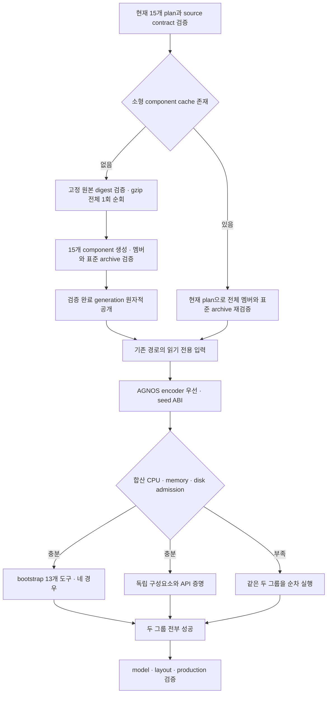

# 검증을 유지하는 CI 병목 개선 — #649

추적: [#649](https://github.com/bin9208/openpilot-rust/issues/649), [#598](https://github.com/bin9208/openpilot-rust/issues/598), [#600](https://github.com/bin9208/openpilot-rust/issues/600), [#605](https://github.com/bin9208/openpilot-rust/issues/605).

## 현재 소스와 우선순위

- 2026-11-01 사용자가 이 작업을 우선하고 다른 세션의 기존 #598 구현을 보류했다.
- 기준 소스는 PR #611의 `44fbc7a34526950063713fd8255b96b0e543f554`다. 기존 입력과 encoder fresh 회귀 수정은 보존한다.
- 별도 작업 트리의 `codex/fix-649-ci-bottlenecks`에서 구현한다. 기존 체크아웃의 미커밋 수정과 실행 중인 Actions는 보존한다.
- `bin-actions2/3`는 사용자 정비 중이다. 러너 복구·서비스 시작·기기 접속을 하지 않는다. 온라인 복구는 사용자가 직접 한다.
- dev-md는 콤마 설치용 최상위 통합 브랜치다. CI DAG 변경은 별도 dev-md PR로 검증하며 dev/main으로 역통합하지 않는다.

## 구현과 검증 상태

- [x] 같은 원본의 15개 provider를 한 번 순회하고 검증된 작은 component를 재사용한다.
- [x] 기존 단일 provider의 descriptor/archive/tree와 동등성을 Actions에서 확인한다.
- [x] 실제 같은 입력·러너에서 cold 12분 이하, warm 3분 이하를 확인한다.
- [ ] recovery를 독립 검사로 옮기고 공개 gate에 같은 source/base/실제 execution 증거를 결속한다.
- [ ] PTY 종료의 원래/네이티브 실패를 정확히 재현하고 재시도/허용값 완화 없이 수정한다.
- [ ] AGNOS 단계 계측과 자원 admission 기반 독립 그룹, UI/Card case 병렬화를 확인한다.
- [ ] dev-md의 불필요한 직렬 needs와 오래된 fast checks 요구를 정리하고 기존 4개 gate·전달 조건을 검증한다.

로컬은 Rust 서식·구문과 diff만 확인한다. 기능·빌드·성능·ARM/AGNOS 결과는 Actions로 확인한다. 구현이나 실행 등록만으로 성공 처리하지 않는다.

## Provider batch 인터페이스

공통 Rust PR에서는 독립 recovery와 workspace·모듈 검사가 각각 실행되고, 기존 `rust checks`는 모두의 성공을 요구한다. 입력 공개 도구는 별도 수동 실행에서 source SHA·PR base·실제 실행 attempt·runner 영수증을 다시 확인한다. UI는 세 그룹의 전체 13개 case가 성공해야 하며, Card/CAN은 전체 reference 성공 후 IPC lifecycle에 진입한다.

`build-runtime-ffmpeg --export-released-provider-batch --plan ... --plan ... --source-root ... --cache ... --store ... --output ...`는 같은 원본의 profile을 일괄 준비한다. 기존 단일 명령은 유지한다.

batch의 profile별 Export는 기존 필드를 유지하며 `origin`은 작은 component에서 원본 manifest/provenance와 현재 plan을 검증한 prefix다. `origin.asset`은 실제 소비한 component 파일의 영수증이며 원본 전체를 새로 내려받았다고 주장하지 않는다. 원본 전체의 SHA와 실제 순회·전송량은 batch 최상위에 따로 기록한다.

캐시 적중에도 작은 archive의 전체 멤버·크기·mode·alias·manifest를 검사하고 현재 source contract를 다시 확인한다. 저장 영수증을 기대값의 근거로 삼지 않는다. 기존 프로젝트 실행 파일은 선택하지 않으며 source-bound MPC/Panda/DBC/eGPU 입력에는 기존 계약을 유지한다.

## 2026-11-01 중간 증거

- provider 계약 검사 `a2d5f93839fcfc900c0774abe406fe5b1cc922fc`, [Actions 41235682321](https://github.com/bin9208/openpilot-rust/actions/runs/41235682321): 기존·신규 안전성/동등성 16개 통과. 뒤따른 Clippy의 불필요한 참조 1건 때문에 전체 실행은 실패했다. 해당 경고는 `49ec9d63d`에서 수정하고 실제 ARM 비교를 [41235936846](https://github.com/bin9208/openpilot-rust/actions/runs/41235936846)에 요청했다. 성능 목표 달성은 아직 확인하지 않았다.
- recovery 비교 명령과 evidence 업로드를 변경하지 않고 독립 hosted X64 작업으로 이동했다. workspace의 fmt/Clippy/전체 Cargo test/build는 유지한다. 최종 `rust checks`와 입력 공개 gate 모두 recovery 성공 및 별도 원본 PR 실행 영수증을 요구한다.
- PTY EOF와 `Popen.poll()` 사이의 경합을 확인했다. 최초 수정의 원본 파일 변경은 MPC의 전체 원본 contract를 무효화해 되돌렸다. 비교 listener의 명시적 관측 경계에서 해당 자식을 잠금 밖에서 최대 2초 회수하며 실제 종료 코드만 전달한다. 원본 함수 본문·고정 source contract와 native 비교 assertion은 유지하고, 관측 전 `None`과 실제 자식 종료 코드를 별도 기록한다. 0/7을 구별하는 실제 자식 재현을 Actions에 추가했다. 런타임 정책·권한·입력 제한은 바꾸지 않는다.

## 독립 case 실행 구조

- UI는 정책·기하 5개, 픽셀 5개, lifecycle·안전 3개로 나눈다. 각 그룹은 별도 프로세스·Xvfb·DISPLAY·TMPDIR·IPC prefix·출력 경로를 소유한다. 전체 13개가 중복·누락 없이 성공해야 최종 PASS다.
- Card/CAN은 원래 shared·브랜드·CAN 비교의 명령·인수를 그대로 case 목록으로 옮긴다. 실제 affinity와 가용 메모리/cgroup·합산 예상 디스크 증가량으로 동시 수를 정한다. IPC lifecycle은 reference의 완전한 성공 영수증을 읽은 뒤에만 시작한다.
- Cargo/test의 새로운 전역 제한을 추가하지 않는다. 폐지된 25/35 GiB 고정 규칙이 남아 있던 Card 공통 admission과 UI safety의 사전 검사만 작업별 증가량으로 바로잡는다.
- Actions 회귀 검사는 기존 소스의 모든 case/argv와 새 목록을 비교하고, 실제 자식 프로세스의 동일 임시 파일명·IPC prefix 격리 및 실패 전파를 검사한다. 실제 UI/Card 성공과 병목 개선은 전체 필수 Actions에서 추가 확인해야 한다.

## AGNOS 구성과 encoder 재사용 실패 원인

- 기존 #598의 `44fbc7a34526950063713fd8255b96b0e543f554` [Actions 41222239366](https://github.com/bin9208/openpilot-rust/actions/runs/41222239366)은 encoder 재사용의 `fresh` assertion에서 실패했다. 보존 artifact의 Cargo fingerprint는 `openpilot/system/hardware/comma/agnos.json`의 원래 dangling symlink를 매번 missing으로 판정했다. 초기/재사용 encoder 바이트는 같았으나 실제 불필요한 재빌드가 발생했으므로 성공으로 인정하지 않는다.
- logging/loggerd의 build script는 사라진 tracked 입력의 기존 부모를 관측하도록 고친다. Git HEAD/index/ref와 실제 소스 변경 감지는 유지한다. 실제 Cargo 재사용 검사에 dangling symlink와 링크 변경을 포함한다. `fresh` assertion을 제거하거나 재시도하지 않는다.
- AGNOS는 공통 준비·encoder·seed·각 구성요소·model·최종 layout/production의 시간과 실패를 기록한다. seed 준비 이후 독립 bootstrap 도구 증명과 구성요소를 같은 작업에서 병행한다. bootstrap의 기존 네 경우/13개 도구·원래 argv/검증 조건은 유지한다. 합산 memory/disk/affinity admission이 부족하면 순차 실행한다. bootstrap의 별도 target/store와 출력만 사용하며 두 그룹 성공 후 최종 단계에 진입한다.

## 표준 archive와 현재 통합 상태

캐시 descriptor의 digest 자체는 독립 pin이 아니므로 소형 component의 멤버 검증 뒤 기존 exporter의 표준 archive 바이트도 재계산해 비교한다. payload가 같더라도 gzip header만 바꾸고 descriptor까지 위조한 캐시는 거부한다. 원본 전체 archive를 warm 경로에서 읽거나 해제하지 않는다.

최신 집중 검증 `439d0a94987617d3ab38a93e41d1305fea7b2581`의 [41236609075](https://github.com/bin9208/openpilot-rust/actions/runs/41236609075)는 provider·logging Cargo 재사용·recovery 전체·공개 gate·원래 case/명령·AGNOS 병행 경계가 모두 성공했다. [PR #611](https://github.com/bin9208/openpilot-rust/pull/611)에 같은 SHA를 이어 붙여 전체 필수 검증과 AGNOS를 실행 중이다. 후속 Card 회귀와 표준 archive 검사 변경은 다시 집중 검증한 뒤 갱신한다.

[PR #606](https://github.com/bin9208/openpilot-rust/pull/606)의 `53636ff7bcd794d5990af0b913ef7dbb5a9ff422`와 비교해 native-cache·다운로드 캐시·action archive 캐시 구현이 동일함을 확인했다. 이를 재작성하지 않는다. PR #611의 추가 PR 실행 영수증·native ARM 경로는 그대로 보존한다. 두 PR의 기존 통합·병합 후 검증은 미완료이며 이 작업을 이유로 우회하지 않는다.

세 X64 러너의 label은 GitHub 등록 메타데이터에서 일치시켰다. ID24에 `openpilot-rust`만 추가했고 ID23/24의 offline 상태와 기존 label은 유지했다. 서비스 시작·정비 복구·Actions 취소를 하지 않았다.

## 2026-11-01 후속 검증

- `38d12c49ef6c34e0c4b005f8b4c7f76a04678511`의 [집중 검증 41239747046](https://github.com/bin9208/openpilot-rust/actions/runs/41239747046)은 provider 17개·실제 Cargo 재사용·recovery 전체·공개 gate 33개·기존 명령 및 병렬 경계 검사를 모두 통과했다.
- 같은 exporter/lock을 사용하는 `96db9a64b77b35a4918611c984c8c9a4f422a1bb`의 [AGNOS 41238362335](https://github.com/bin9208/openpilot-rust/actions/runs/41238362335)는 입력 준비에서 전체 원본 1,155,969,168 bytes를 정확히 한 번 순회하고, 기존 raw cache로 HTTP body 전송 0 bytes, batch 자체 354.892초를 기록했다. 해당 실행 전체는 이후 계측 함수 이름 충돌로 실패했으므로 전체 성공·warm 성능 증거로 사용하지 않는다. 현재 후보는 이 이름 충돌과 기존 PRoot guest export 경로 호환성을 수정했다.
- [실제 ARM 비교 41238463727](https://github.com/bin9208/openpilot-rust/actions/runs/41238463727)은 cold/warm 뒤 기존 단일 export 15개와 tree·descriptor·archive를 같은 VM에서 비교 중이다. 전체 성공과 warm 3분 목표는 아직 미확정이다.
- 감사에서 새 batch 하위 모듈과 AGNOS 준비 helper의 push 경로 누락을 확인했다. 기존 branch/event 범위를 유지하면서 이 의존 경로만 추가한다. batch의 순회·바이트·전송·시간 영수증도 기존 artifact에 명시적으로 보존한다.

## 2026-11-01 실제 ARM 비교와 후속 실패

- 초기 exporter `49ec9d63da7fdf60d822f7803ae7c7bc977fb1da`의 [41235936846](https://github.com/bin9208/openpilot-rust/actions/runs/41235936846)은 15개 전부의 tree·descriptor·archive 바이트 일치를 통과했다. 같은 VM의 기존 8개 companion 합계는 3,704.567초, batch cold 443.346초(원본 1회), warm 89.300초(원본 없음·순회/전송 0)다. 별도 원본 prefetch는 125.731초다. 이후 추가된 표준 archive 재계산까지 포함하는 최신 exporter 성능은 [41238463727](https://github.com/bin9208/openpilot-rust/actions/runs/41238463727)에서 계속 확인한다. 초기 수치를 최신 구현의 완료 증거로 대체하지 않는다.
- `38d12c49ef6c34e0c4b005f8b4c7f76a04678511`의 [AGNOS 41240265625](https://github.com/bin9208/openpilot-rust/actions/runs/41240265625)는 encoder의 원본 codec 5개·실제 Cargo fresh 재사용과 seed ABI를 통과했다. admission은 4 CPU, 가용 memory 15.54 GB, disk 100.49 GB로 두 그룹 병행을 허용했다. 이후 기존 companion fixture의 `ILP64 SVD result` assertion에서 실패했고, 이에 따라 새 bootstrap 자식만 종료됐다. cgroup OOM/limit event는 0이었다. 전체 성공으로 인정하지 않는다.
- 정확한 반환값이 기존 stderr에 없어 fixture에 16진 부동소수점 진단을 추가한다. 별도 수동 ARM 재현은 동일 provider를 현재 plan과 표준 archive까지 재검증한 뒤 원래 SVD assertion을 그대로 실행한다. 수치 허용값·runtime 정책·원본 비교를 완화하지 않고 원인을 먼저 확인한다.
- [#653 수동 ARM 재현 41247090318 / job 124672660333](https://github.com/bin9208/openpilot-rust/actions/runs/41247090318/job/124672660333)의 artifact `13060455328`에서 실제 `info=0`, singular 값 `0x1.7ffffffffffffp+1`, `0x1.0000000000001p+1`을 확인했다. 각각 3의 바로 아래, 2의 바로 위 double이며 1 ULP 차이다. tree `5e4960d1cd4d595ff4b6727f2a84b91699d1759772ccf6ff3c5acb77a8dea777`와 archive `0590119e68a7a119581e4817dc1334fb7f921f5106dc7dadc14d2465822b8de8`는 기존 단일 export와 일치한다.
- 원래 diag(3,2) SVD case를 유지하면서 이 작은 CI ABI fixture만 인접 double 한 칸으로 제한한다. 2 ULP·실패 info·음수·순서 변경·NaN·무한대는 거부하고 diag(4,2)의 bit-exact case를 추가한다. runtime·모델 정밀도와 기존 원본 비교 기준은 바꾸지 않는다. 수정된 실제 ARM·전체 AGNOS 성공은 계속 필요하다.
- 수정 `39c9d92e2f0245352dd6ed66c1470f1f684494b6`의 [ARM job 124675426535](https://github.com/bin9208/openpilot-rust/actions/runs/41248021030/job/124675426535)은 성공했다. artifact `13059669656`은 원래 case의 같은 1 ULP 값과 추가 dyadic case의 정확한 `0x1p+2,0x1p+1`을 보존한다. 거부 경계 self-test도 같은 실행에서 성공했다. [집중 검증 41248008946](https://github.com/bin9208/openpilot-rust/actions/runs/41248008946) 전체도 성공했으며 이제 공통 PR의 전체 AGNOS에서 확인한다.

## 표준 archive 검증을 포함한 동일 VM 성능 증거

`7a89ba78f47c25dc5698e6293315fdea253548b7`의 [ARM benchmark job 124645339328](https://github.com/bin9208/openpilot-rust/actions/runs/41237656640/job/124645339328)은 전체 성공했다. artifact `13059921474`는 15개 단일 export 각각과 batch의 tree·descriptor·archive 바이트 일치, 모든 case의 exit 0, 성능 assertion 성공을 보존한다.

| 같은 VM·입력·Rust 1.94.0 측정 | 초 | 결과 |
| --- | ---: | --- |
| 별도 원본 prefetch | 108.442 | 1,155,969,168 bytes 원본 준비 |
| 기존 8개 companion 합계 | 3,682.832 | 61분 23초 |
| 새 15개 전체 cold | 549.405 | 원본 gzip 1회 · 9분 9초 |
| prefetch + cold | 657.848 | 다운로드 포함 10분 58초 |
| 새 15개 전체 warm | 178.761 | 원본 경로 없음 · 순회/원본 bytes/HTTP bytes 모두 0 |

현재 `39c9d92e2f0245352dd6ed66c1470f1f684494b6`와 비교해 모든 컴파일 대상 Rust 파일·Cargo.lock·profile/contract가 같다. `rust/`의 유일한 차이는 이 benchmark가 호출하지 않는 `rust/tools/ci_cases.py`이며, benchmark job 전체·harness·runner policy·job-temp/rust-path setup도 동일하다. 이 비교는 성공한 ARM job 내부의 짝지은 측정이다. 해당 workflow의 별도 execution-contract job은 당시 누락된 Python `zstandard` 때문에 실패했고 후속 집중 검증에서 수정됐다. 실패 workflow 전체의 경과를 성공 기준으로 사용하지 않는다. 추가 최신 SHA benchmark `41238463727`도 취소하지 않고 유지한다.

이 성능 증거는 provider 처리의 수용 조건이다. 전체 필수 gate·현재 AGNOS·UI/Card 공유 입력 보호·dev-md 직렬 기준 비교는 별도로 완료해야 한다.

## ARM foundation의 가짜 curl 실행 경합 — #654

공통 후보 `b9c590dc150ba57e2e4f5dad29221a6390e8fb4e`의 [ARM foundation job 124678033356](https://github.com/bin9208/openpilot-rust/actions/runs/41248896562/job/124678033356)은 mirror 회귀의 호출 기록 누락으로 첫 library 검사에서 실패했다. 기존 나머지 실패 수집 단계에서는 34개가 모두 통과했으나 첫 실패를 성공으로 대체하지 않는다.

진단 소스 `4577f399cb375cbf131e5a4f6b3b43a22ed76a3e`의 [ARM 반복 재현 job 124679928888](https://github.com/bin9208/openpilot-rust/actions/runs/41249525491/job/124679928888)은 기본 병렬 library 검사 81번째에서 `Err(Os { code: 26, kind: ExecutableFileBusy, message: "Text file busy" })`를 보존했다. 새 fake curl 스크립트의 실행 오류가 뒤따르는 journal 읽기 오류에 가려졌다. [#654](https://github.com/bin9208/openpilot-rust/issues/654)로 추적한다.

실제 production `/usr/bin/curl` 명령·인수·retry·전송량·mirror 판정은 유지하고, private command 생성 경계에서 테스트 스크립트만 `/bin/sh`의 읽기 입력으로 전달한다. writable fd를 강제로 보유해 기존 직접 실행의 오류 26을 재현하고 새 실행은 retry 없이 성공해야 하는 회귀를 추가한다. 전역 Cargo/test 병렬 제한은 도입하지 않는다. 같은 ARM 병렬 검사 200회 전부와 전체 foundation의 성공은 후속 Actions에서 확인한다.
